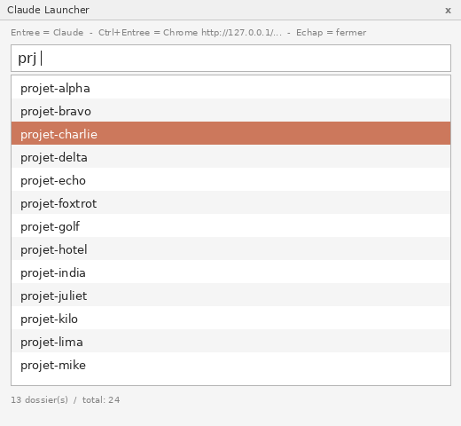

# Claude Launcher

A tiny Windows tray app that opens [Claude Code](https://www.anthropic.com/claude-code) (or any CLI) in the right project folder, in two keystrokes.



## Why?

If you work on dozens of small projects living in the same root folder
(`C:\wamp64\www`, `C:\laragon\www`, `C:\src`, `~/projects`, whatever), opening a terminal in
the right one is the same boring dance every time: open PowerShell, `cd ...`,
then run your tool. This app removes the dance.

Click the tray icon (or assign a global hotkey to it), start typing the
folder name, hit `Enter`. Done.

## Features

- **Lives in the system tray** — no taskbar clutter, no extra window hanging around.
- **Type-to-filter folder picker** — opens near the tray, filters as you type.
- **Keyboard-first** — arrows to navigate, Enter to launch, Escape to dismiss.
- **`Enter`** opens [Windows Terminal](https://github.com/microsoft/terminal)
  (or PowerShell as fallback) in the selected folder and runs `claude`
  (or any command you configure).
- **`Ctrl+Enter`** opens Chrome on a URL pattern that includes the folder name
  — handy for WAMP/XAMPP/Laragon setups where each project has its own local URL.
- **`Shift+Enter`** opens the selected folder in Windows Explorer.
- **Right-click** an item to copy its full path to the clipboard.
- **Single instance** — launching it twice won't give you two tray icons.
- **External JSON config** — root folder, exclusions, command, URL pattern.
- **No dependencies** — pure PowerShell + WinForms. ~430 lines, single file.

## Install

1. Clone the repo (or download the ZIP) into a folder of your choice. The
   defaults assume projects live in `C:\wamp64\www`, but anywhere works
   (just update `ProjectsRoot` in your `config.json`). The launcher's own
   folder is automatically left out of the list.
2. Set up your config — either copy the template:
   ```powershell
   Copy-Item config.example.json config.json
   ```
   …or just skip this step and let the script auto-create `config.json` with
   the default values on first run. Either way, `config.json` is git-ignored,
   so your local tweaks won't end up in commits.
3. Double-click **`Start-Hidden.vbs`** — a tray icon (orange "C" with a yellow
   lightning bolt) appears in your notification area.
4. *(Optional)* Right-click **`Install-Startup.ps1`** → **Run with PowerShell**
   to launch automatically with Windows.

> `Start-Hidden.vbs` and `Start-Debug.bat` already pass `-ExecutionPolicy Bypass`.
> If you run `ClaudeLauncher.ps1` directly and it's blocked, run
> `Set-ExecutionPolicy -Scope CurrentUser RemoteSigned` once.

> **Installed inside your web root?** The shipped `.htaccess` denies all HTTP
> access to the folder (Apache), so `config.json` and the scripts aren't served.

## Usage

**Click** the tray icon to open the search window in the bottom-right corner
(of the screen the mouse is on).

| Key                  | Action                                                                  |
|----------------------|-------------------------------------------------------------------------|
| Type letters         | Filters the project list in real time (plain substring, case-insensitive). |
| `Up` / `Down`        | Navigate the list.                                                      |
| `Enter`              | Open Windows Terminal in the selected folder and run `claude`.          |
| `Ctrl+Enter`         | Open Chrome on `http://127.0.0.1/<folder-name>` (URL pattern configurable). |
| `Shift+Enter`        | Open the selected folder in Windows Explorer.                           |
| Right-click an item  | Select it and copy its full path to the clipboard.                      |
| `Escape` / click out | Hide the window (app stays in the tray).                                |

**Right-click** the tray icon for the menu:

- Open the launcher
- Open the root folder in Explorer
- Open `http://127.0.0.1` in Chrome
- Refresh the project list
- Quit

## Configuration

Everything lives in **`config.json`**, next to the script. The file is
git-ignored — only `config.example.json` ships with the repo as a template.
Copy it (or let the script auto-create one) and edit freely:

```json
{
    "ProjectsRoot":     "C:\\wamp64\\www",
    "SearchDepth":      1,
    "ExcludeFolders":   [".git", "node_modules", "vendor"],
    "ClaudeCommand":    "claude",
    "ChromeUrlPattern": "http://127.0.0.1/{name}"
}
```

| Key                | What it does                                                                        |
|--------------------|-------------------------------------------------------------------------------------|
| `ProjectsRoot`     | Folder to scan for projects. JSON-escape backslashes: `C:\\path\\to\\projects`.     |
| `SearchDepth`      | `1` = direct subfolders only; `2` = one level deeper; etc. Minimum `1`. With `2`+, the list shows relative paths (`app1\src`) so same-named folders stay distinct. |
| `ExcludeFolders`   | Folder names to skip (matched by basename, not path). Excluded folders are not descended into. The launcher's own folder is always skipped. |
| `ClaudeCommand`    | Command to run after `cd`-ing into the project. Defaults to `claude`. Could be `code .`, `gemini`, `cursor .`, etc. |
| `ChromeUrlPattern` | URL opened by `Ctrl+Enter`. The placeholder `{name}` is replaced by the folder's path relative to `ProjectsRoot`, URL-encoded, with `/` separators. |

If `config.json` is missing, it's created from defaults on next run. If the
JSON is invalid, you get a non-blocking warning and the defaults are used.

After editing `config.json`, **restart the launcher** (right-click tray → Quit,
then relaunch `Start-Hidden.vbs`) to apply changes.

## File layout

```
claude-launcher/
├── ClaudeLauncher.ps1      # main script (tray app, search window, keybindings)
├── config.example.json     # template — copy to config.json on first install
├── config.json             # your settings (git-ignored, auto-created if missing)
├── icon.ico                # tray icon (Claude-style spark + lightning bolt)
├── Start-Hidden.vbs        # launches the script with no console window
├── Start-Debug.bat         # launches with console visible (for debugging)
├── Install-Startup.ps1     # adds a shortcut to %APPDATA%\...\Startup
├── screenshot.png          # for this README
├── LICENSE
├── .htaccess               # denies HTTP access when installed in a web root
├── .gitignore
└── README.md
```

## How it works

A single PowerShell script bootstraps a Windows Forms `NotifyIcon` and keeps a
hidden top-most window around. The window only shows when you click the tray
icon. The list of folders is enumerated once on show (and on demand via the
right-click menu) by walking the tree up to `SearchDepth`, skipping excluded
folders. A named mutex prevents a second instance from starting. The keyboard handling lives at
the form level (`KeyPreview = $true`) so `Enter`, `Escape`, and arrow keys
work regardless of which control has focus. The list is rendered in
owner-draw mode for the alternating-row look.

When you launch a project, the script prefers `wt.exe` (Windows Terminal) and
falls back to plain `powershell.exe`. The `Ctrl+Enter` Chrome shortcut probes
the usual Chrome install paths and falls back to the default browser.

## Troubleshooting

| Symptom                                  | Fix                                                                           |
|------------------------------------------|-------------------------------------------------------------------------------|
| Tray icon doesn't appear after launch    | Run `Start-Debug.bat` to see the error in a visible console.                  |
| "Running scripts is disabled on this system" | `Set-ExecutionPolicy -Scope CurrentUser RemoteSigned` in PowerShell.       |
| `claude` is not recognized               | Make sure `claude` works from a normal PowerShell session first. Add to `PATH`. |
| Icon file is fine on disk but the tray shows the old one | Windows icon cache. Run `Stop-Process -Name explorer -Force; Start-Process explorer`. |
| Selection in list looks weird            | The list uses `DrawMode = OwnerDrawFixed`. Visual style is hardcoded in `ClaudeLauncher.ps1`. |

## Uninstall

1. Right-click the tray icon → **Quit**.
2. Delete `Claude Launcher.lnk` from `shell:startup` (paste that into the
   Explorer address bar).
3. Delete the project folder.

## Credits

Vibe-coded with [Claude](https://www.anthropic.com/claude). The whole thing —
icon, PowerShell, JSON config, README — came out of a chat. The screenshots
above are the actual mockups Claude generated while we were iterating on the
design.

## License

[MIT](LICENSE) © Jerome Salanhac
